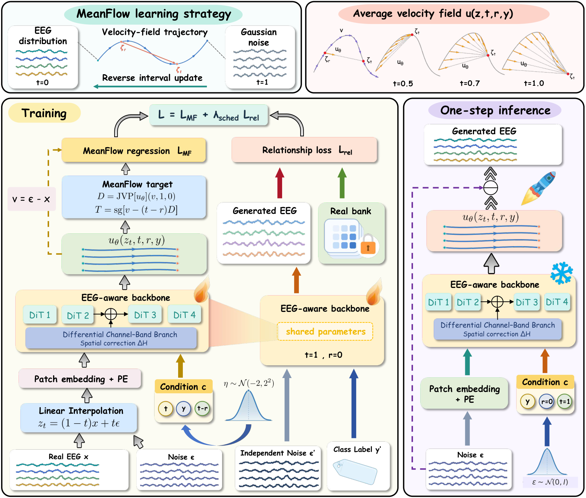
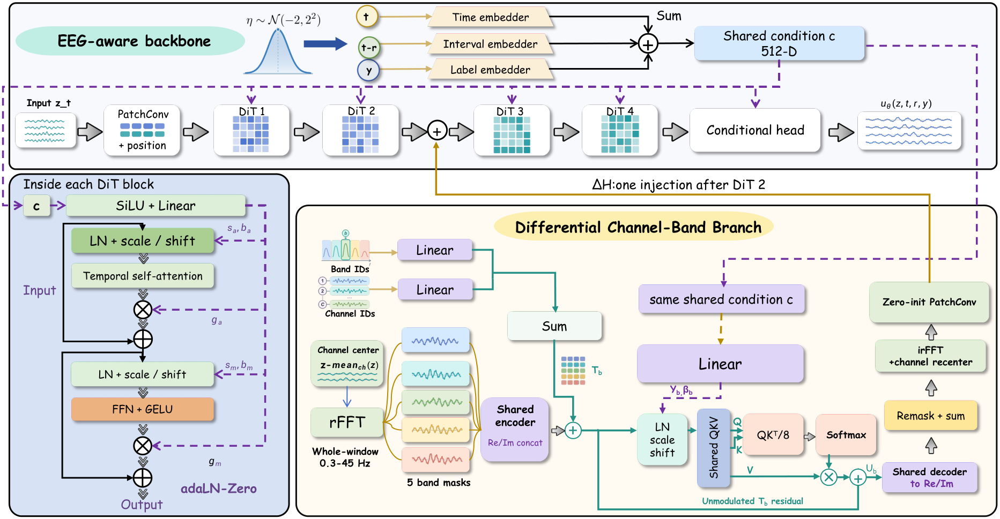
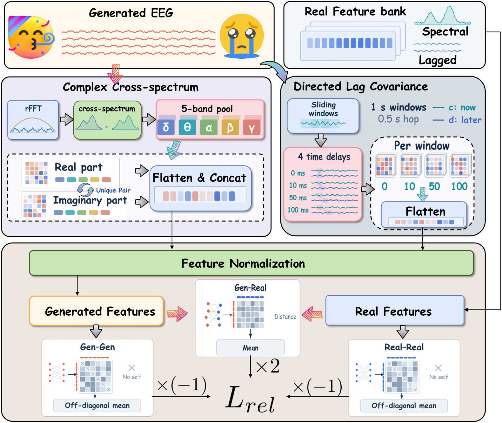

# 🧠 EEGMeanFlow

**One step from noise to class-conditional EEG.** 🌱

An implementation of EEGMeanFlow for class-conditional EEG generation: prepare the data, train the model, and generate signals in one step. 🌱

[](assets/process.pdf)

## ✨ The method

EEGMeanFlow adapts [MeanFlow](https://arxiv.org/abs/2505.13447) to class-conditional EEG generation. It combines three components:

- **Conditional average flow.** A time- and class-conditioned transformer learns the average velocity between two times. Inference uses a single network evaluation: `EEG = noise − velocity(noise, t=1, r=0, class)`.
- **Frequency–spatial branch.** A differential-channel branch processes the real and imaginary Fourier coefficients in five EEG bands, models channel relationships, and adds its correction after the second transformer block. The main backbone retains the complete waveform.
- **Relationship loss.** Class-conditioned energy U-statistics match complex cross-spectrum and local lag-covariance distributions. Feature normalization and the frozen reference bank are fitted only to real training data.

The model uses class labels but **does not use classifier-free guidance at inference**. Label dropout during training is 0.1. No classifier or downstream decoder is required for generation.

### 🧩 EEG-aware backbone

[](assets/backbone.pdf)

### 🌈 Relationship loss

[](assets/loss.pdf)

Click any diagram to open its original vector PDF.

## 🌷 Data preparation

The provided preprocessing pipeline uses FACED recordings.

- [Official dataset on Synapse](https://www.synapse.org/Synapse:syn50614194)
- [Dataset paper — Scientific Data](https://www.nature.com/articles/s41597-023-02650-w)

Download and extract the official **Processed_data** waveform files. The input is one `.pkl` per subject with shape `(28 videos, 32 channels, 7500 samples)` at 250 Hz. Use the waveforms, rather than the DE/PSD feature files. Keep the official channel and video order.

The nine class IDs are:

| ID | Emotion | ID | Emotion | ID | Emotion |
|---:|---|---:|---|---:|---|
| 0 | Anger | 3 | Sadness | 6 | Inspiration |
| 1 | Disgust | 4 | Neutral | 7 | Joy |
| 2 | Fear | 5 | Amusement | 8 | Tenderness |

### Preprocessing

The released Processed_data waveforms already include the dataset authors’ preprocessing. This code then applies our experimental pipeline:

1. Split each 30-second video recording into three non-overlapping **10-second** segments.
2. FFT-resample each segment from **250 Hz to 200 Hz**.
3. Apply a **0.3–45 Hz Butterworth bandpass**, with SciPy `N=4` and zero-phase `sosfiltfilt`. This filter implementation is our experimental choice.
4. Store signals in **µV**. The training loader divides by **100** once; generation converts back to µV.

No additional rereferencing or per-trial amplitude normalization is applied. The frequency–spatial branch subtracts the instantaneous channel mean internally; it does not rereference the model input.

| Split | Subject positions¹ | 10-second segments |
|---|---|---:|
| Train | 1–80 | 6,720 |
| Validation | 81–100 | 1,680 |
| Held-out | 101–123 | 1,932 |

¹ Subjects are sorted numerically by filename. Both `0–122` and `1–123` numbering are accepted. These counts assume all 123 supplied files are retained. Training and model selection read only the training and validation splits, respectively.

## 🚀 Quick start

Use Python 3.11 or later. Install a PyTorch build compatible with your GPU first, then install the remaining dependencies:

```bash
python -m venv .venv
# Linux / macOS
source .venv/bin/activate
# Windows PowerShell: .venv\Scripts\Activate.ps1
pip install -r requirements.txt
```

### 1 · Prepare

```bash
python preprocess.py --input data/Processed_data --output data/processed --input-unit uV
```

Specify `--input-unit V` instead if your waveform files are in volts. The script never guesses the physical unit. Use only pickle files obtained from the dataset’s trusted distribution.

### 2 · Train

```bash
python train.py --data data/processed --output outputs/eegmeanflow --device cuda:0
```

| Setting | Default |
|---|---|
| EEG shape | 32 channels × 2,000 time points |
| Transformer | 4 blocks · width 512 · 16 heads · patch size 5 |
| Frequency–spatial branch | Width 64 · five frequency bands |
| Epochs / effective batch | 2,000 / 64 |
| Microbatch | 8, with gradient accumulation |
| Optimizer | AdamW · learning rate 5e−4 · weight decay 0.05 |
| Schedule | Cosine decay per update to 1e−6 |
| Gradient clipping / EMA | 1.0 / 0.9999 |
| Relationship coefficient | 0.1, starts after epoch 50 and ramps over 100 epochs |
| Relationship update | Every 4 updates, multiplied by 4; 8 generated samples per class |
| Lag intervals | 0, 10, 50, 100 ms |

The relationship endpoint is generated directly from independent noise with one differentiable model call. The reference features are fixed; gradients flow through the generated features and model.

The trainer selects `best.pt` by the lowest class-averaged validation spectral/spatial MMD², comparing raw and EMA weights. Standardization and PCA32 are fitted to the training split. Validation uses fixed noise and 128 real and generated samples per class, with a three-bandwidth RBF kernel. It runs at initialization and after every epoch. `--val-every` changes this frequency; `--val-per-class` changes its sample budget.

`last.pt` stores optimizer and scheduler state for resuming the same training run:

```bash
python train.py --data data/processed --output outputs/eegmeanflow --device cuda:0 --resume
```

Keep the original settings when resuming. `history.jsonl` records the training loss and validation score. The entry point runs on one GPU; choose the GPU with `--device`. Mixed precision is not enabled because training uses a forward-mode JVP and complex-valued frequency features.

### 3 · Generate

```bash
# 128 segments for each of the nine classes
python generate.py --checkpoint outputs/eegmeanflow/best.pt --output outputs/generated.npz

# Only Anger and Joy, 64 segments each
python generate.py --checkpoint outputs/eegmeanflow/best.pt --classes 0 7 --per-class 64 --output outputs/anger_joy.npz
```

The output contains `x` with shape `(N, 32, 2000)` in **µV**, integer labels `y`, `sample_rate=200`, and class names. Noise is seeded per sample, so changing the inference batch size retains the same noise inputs.

```python
import numpy as np
samples = np.load('outputs/generated.npz')
eeg, labels = samples['x'], samples['y']
```

## 🧺 Repository layout

```text
EEGMeanFlow/
├── README.md
├── assets/                   # original diagrams (PDF) and README previews (PNG)
├── preprocess.py             # raw waveforms → LMDB
├── train.py                  # MeanFlow + relationship loss
├── generate.py               # one-step class-conditional generation
├── eegmeanflow/
│   ├── data.py
│   ├── meanflow.py
│   ├── relationship.py
│   ├── energy.py
│   ├── features.py
│   ├── validation.py         # training-time checkpoint selection
│   └── models/               # transformer and frequency–spatial branch
├── requirements.txt
└── LICENSE
```

## 💛 Acknowledgments

The transformer backbone is adapted from [EEGDiffuser](https://github.com/wjq-learning/EEGDiffuser), whose model code builds on DiT. The average-flow objective follows [MeanFlow](https://arxiv.org/abs/2505.13447). The original copyright notices and license are retained. Please cite the [FACED dataset paper](https://doi.org/10.1038/s41597-023-02650-w) when using its data.
